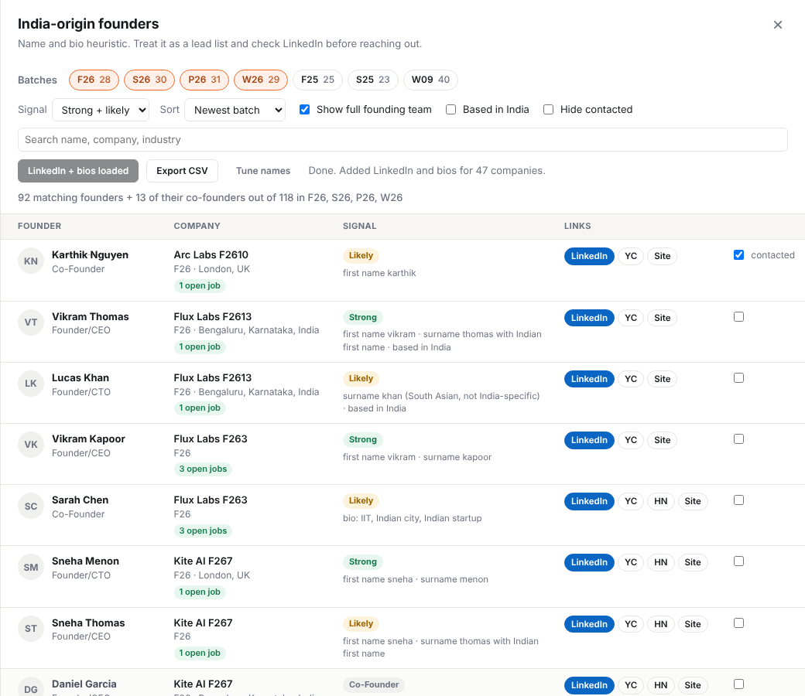

<p align="center">
  
</p>

<h1 align="center">YC India-Origin Founder Finder</h1>

<p align="center">
  A Chrome extension for the <a href="https://www.ycombinator.com/founders">YC founders directory</a> that pulls every founder from the batches you pick and surfaces the ones with Indian-origin signals, along with their LinkedIn, their co-founders and whether the company is hiring.
</p>

<p align="center">
  
  <br>
  <sub>Screenshot uses made-up demo data.</sub>
</p>

## Why

Cold outreach works better when there's some common ground. The YC directory has thousands of founders, but there's no way to filter by background, see who's hiring, or track who you've already messaged. This adds all of that on top of the page YC already gives you.

## Features

- **Batch picker.** Loads the four newest batches by default (for example F26, S26, P26, W26). Click any chip to add older ones.
- **Signal levels.** Every founder gets a Strong, Likely or Weak label, and each row shows why it matched.
- **Full founding teams.** Shows the co-founders of every matched company, so you know who else to reach out to.
- **LinkedIn, X, bios and open jobs.** One click fetches each company's YC page and adds social links, founder bios and open job counts. Results are cached for 7 days.
- **Based in India filter.** Narrows the list to founders or companies located in India.
- **Outreach tracking.** Tick "contacted" on a row and it stays ticked across sessions. You can also hide contacted founders.
- **CSV export.** Exports exactly what's on screen, ready for a spreadsheet.
- **Custom names.** Add surnames or first names the built-in lists miss.

## Install

The extension isn't on the Chrome Web Store, so you load it yourself. It takes about a minute.

1. Download this repo: **Code → Download ZIP**, then unzip it. Or clone it:
   ```bash
   git clone https://github.com/snigenigmatic/yc-india-founders.git
   ```
2. Open `chrome://extensions` and turn on **Developer mode** (top right).
3. Click **Load unpacked** and select the folder that contains `manifest.json`.
4. Pin the extension from the puzzle-piece menu.

It works in any Chromium browser: Chrome, Brave, Edge, Arc.

## Use

1. Open [ycombinator.com/founders](https://www.ycombinator.com/founders), or click the extension icon.
2. Click the orange **India-origin founders** button.
3. Pick your batches and signal level.
4. Hit **Get LinkedIn + bios** to fill in links and open job counts.
5. Tick founders off as you contact them, and export a CSV whenever you want.

**Tip:** to keep the fetch quick, start with **Strong only** and one or two batches, then widen.

## How the scoring works

Founders are scored on their name and, once fetched, their bio and location.

| Signal | Points |
| --- | --- |
| Common Indian first name | +2 |
| Common Indian surname | +3 |
| South Asian surname that isn't India-specific (Khan, Shah, Das...) | +2 |
| Surname also common elsewhere (Thomas, D'Souza...), only alongside an Indian first name | +1 |
| Indian middle name | +1 |
| Bio mentions IIT, BITS, NIT, IIM, an Indian city or an Indian startup | +2 |
| Founder or company based in India | +1 |

**4 or more** is Strong, **2 to 3** is Likely, **1** is Weak.

It's a heuristic, so it will miss some people and flag others wrongly. Treat the output as a lead list and check LinkedIn before reaching out. If you notice gaps, use **Tune names**, or open a PR against [`src/names.js`](src/names.js).

## Privacy

- Everything runs in your browser. There's no backend, no analytics and no account.
- It only makes the same requests the YC founders page already makes: YC's own founder search and public company pages.
- Your settings, "contacted" list and cached company data stay in Chrome's local extension storage.

## Project structure

```
manifest.json        Manifest V3 config
background.js        Toolbar icon: opens or toggles the panel
src/data.js          Founder search, batch list, company page parsing
src/scoring.js       Name and bio scoring
src/names.js         First name and surname lists
src/panel.js         The panel UI, filters, tracking, CSV export
src/panel.css        Panel styles, isolated in a shadow DOM
```

No build step. Edit a file, hit reload on `chrome://extensions`, then refresh the YC tab.

## Contributing

Name lists, bio keywords and UI improvements are all welcome. If YC changes its page and something breaks, please open an issue with the console error.

## Disclaimer

This is an independent project, not affiliated with or endorsed by Y Combinator. Be respectful with outreach: keep messages personal and don't spam.

## License

[MIT](LICENSE)
